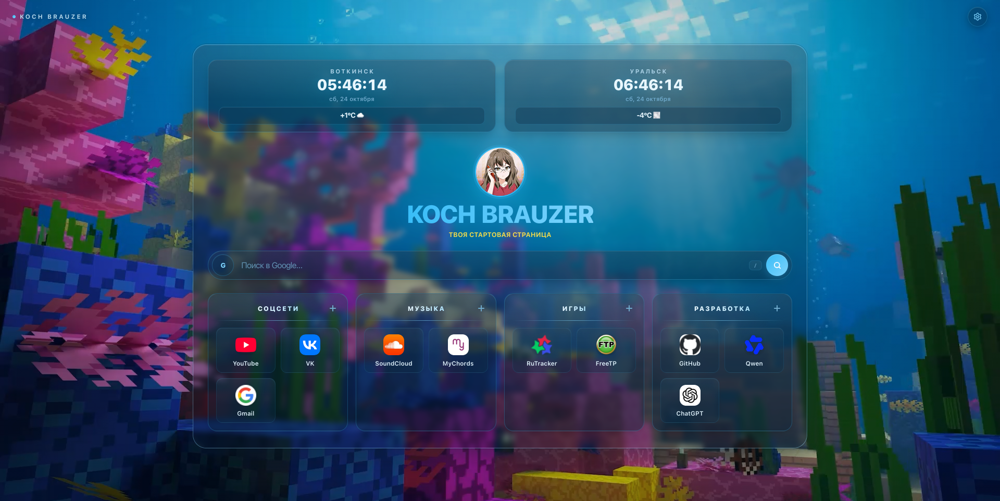
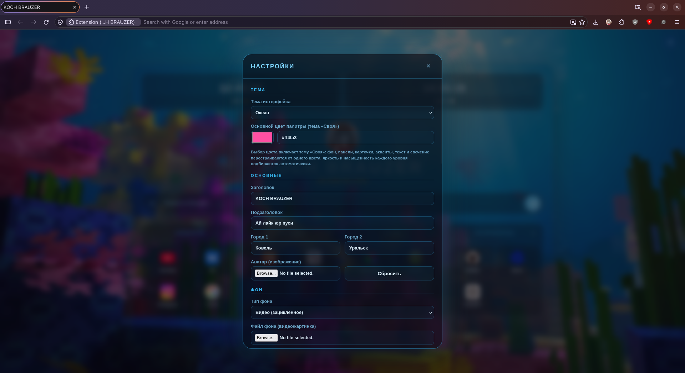
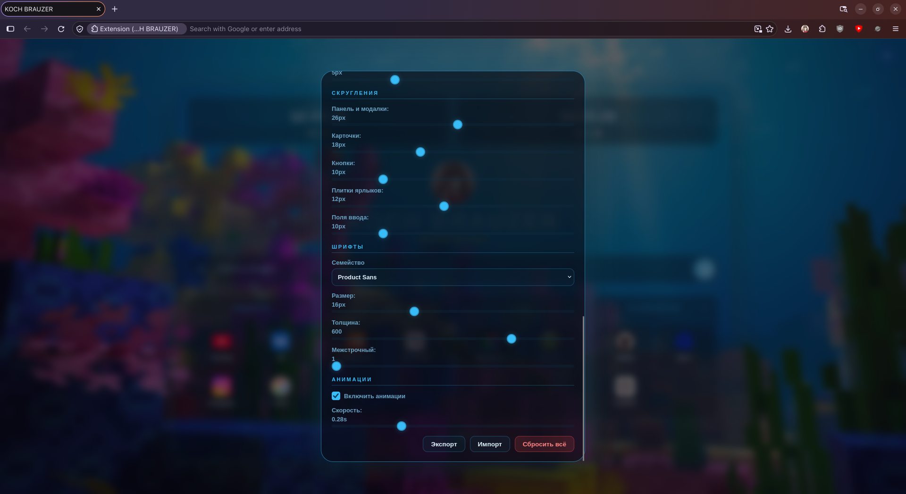

<div align="center">

# 🌸 KOCH BRAUZER

**Минималистичная и красивая страница новой вкладки**<br>
Поиск, погода, часы и ярлыки на одном экране — для Firefox, Edge, Chrome, Opera и Brave.

<br>

[](#-установка)
[](https://addons.mozilla.org/ru/firefox/addon/koch-brauzer/)
[](https://microsoftedge.microsoft.com/addons/detail/koch-brauzer/kmkmnnjonlnhcpdcjfgfhhjepcbakefm)
[](#-установка)
[](#-приватность)
[](#)

<br>

[**🦊 Установить для Firefox**](https://addons.mozilla.org/ru/firefox/addon/koch-brauzer/) &nbsp;•&nbsp;
[**🌐 Установить для Edge**](https://microsoftedge.microsoft.com/addons/detail/koch-brauzer/kmkmnnjonlnhcpdcjfgfhhjepcbakefm) &nbsp;•&nbsp;
[**🛡 VirusTotal**](https://www.virustotal.com/gui/file/e237477b477546fb8d05405e251fc9efa8830f88efab159d7b63d4d27bcc26bc/detection)

<br>

[Возможности](#-возможности) · [Управление](#-управление) · [Скриншоты](#-скриншоты) · [Установка](#-установка) · [Темы](#-темы) · [Производительность](#-производительность) · [Структура](#-структура-проекта) · [Приватность](#-приватность)

</div>

---

## ✨ Возможности

<table>
  <tr>
    <td width="50%" valign="top">
      <h3>🔎 Поиск и история</h3>
      5 движков: Google, DuckDuckGo, Bing, Яндекс, Brave. Адреса и домены открываются напрямую. История до 50 запросов с подсказками, подсветкой совпадений, удалением по одному и полной очисткой.
    </td>
    <td width="50%" valign="top">
      <h3>🕐 Часы и погода</h3>
      Два города с учётом часовых поясов, температура и эмодзи-погода. Данные от open-meteo, без API-ключа. Погода кэшируется и обновляется раз в 30 минут.
    </td>
  </tr>
  <tr>
    <td valign="top">
      <h3>🗂 Категории и ярлыки</h3>
      Создание, редактирование и перетаскивание: ярлыки между категориями, категории за шапку. Иконка ярлыка: favicon сайта, эмодзи или своя картинка. У категории: эмодзи или картинка.
    </td>
    <td valign="top">
      <h3>🎨 8 тем и своя</h3>
      Rose, Purple, Ocean, Green, Dark, Light, Midnight, Sunset. Тема «Своя»: выбираешь один цвет, остальная палитра подбирается автоматически.
    </td>
  </tr>
  <tr>
    <td valign="top">
      <h3>🖼 Фон</h3>
      Цвета темы по умолчанию, зацикленное видео или изображение (файл или ссылка). Настраивается прозрачность фона.
    </td>
    <td valign="top">
      <h3>🧩 Тонкая настройка</h3>
      Прозрачность и размытие панели, карточек, истории и окна настроек. Скругления 5 элементов. Шрифт: 7 семейств, размер, толщина, высота строки, интервалы. Анимации: включение и скорость.
    </td>
  </tr>
  <tr>
    <td valign="top">
      <h3>👤 Заголовок и аватар</h3>
      Свой заголовок и подзаголовок. Аватар: своё изображение (автосжатие до 256 px) или буква-заглушка.
    </td>
    <td valign="top">
      <h3>💾 Бэкапы</h3>
      Экспорт всего профиля одним JSON-файлом: настройки, категории и ярлыки, история поиска, файл фона. Импорт применяется без перезагрузки. Есть полный сброс.
    </td>
  </tr>
</table>

## 📸 Скриншоты

<table>
  <tr>
    <td colspan="2">
      
    </td>
  </tr>
  <tr>
    <td width="50%">
      
    </td>
    <td width="50%">
      
    </td>
  </tr>
</table>

## 🚀 Установка

| Браузер | Как установить |
|:---|:---|
| 🦊 **Firefox** 142+ | [Firefox Add-ons](https://addons.mozilla.org/ru/firefox/addon/koch-brauzer/) |
| 🌐 **Edge** | [Edge Add-ons](https://microsoftedge.microsoft.com/addons/detail/koch-brauzer/kmkmnnjonlnhcpdcjfgfhhjepcbakefm) |
| 🧩 **Chrome / Opera / Brave** | вручную из исходников, см. ниже |

<details>
<summary><b>🛠 Ручная установка из исходников</b></summary>

<br>

**Chrome, Edge, Opera, Brave**

1. Скачай репозиторий (**Code → Download ZIP**) и распакуй.
2. Открой `chrome://extensions` (в Edge: `edge://extensions`).
3. Включи **режим разработчика**.
4. Нажми **Загрузить распакованное** и выбери папку `KOCH-BRAUZER-CHROMIUM`.

**Firefox**

1. Открой `about:debugging#/runtime/this-firefox`.
2. Нажми **Загрузить временное дополнение**.
3. Выбери файл `KOCH-BRAUZER-FIREFOX/manifest.json`.

> Временное дополнение в Firefox сбрасывается после перезапуска браузера. Для постоянной установки используй [Firefox Add-ons](https://addons.mozilla.org/ru/firefox/addon/koch-brauzer/).

</details>

## 🎨 Темы

<div align="center">


</div>

Тема выбирается в **Настройках → Тема** и сохраняется между запусками. Выбор своего цвета включает тему «Своя»: фон, панели, карточки, акценты и текст строятся от одного цвета.

## ⚡ Производительность

- **Один ES-модуль** `scripts/app.js`, без сборки и сторонних библиотек.
- **Одно чтение хранилища на запуск**, настройки кэшируются в памяти.
- **Часы рисуются сразу**, геокодинг и погода догружаются в фоне. Координаты и погода кэшируются, поэтому новая вкладка не ждёт сеть.
- **Медиа в IndexedDB** (блобы), а не base64 в настройках: хранилище не раздувается.
- **Скрытая вкладка или свёрнутое окно:** видео останавливается и освобождает декодер, таймеры часов и погоды не работают.
- **Стекло панели:** на однотонном фоне размытие отключено, при фоне-картинке заменено на заранее размытый слой. Размытие над видео остаётся на `backdrop-filter`.
- **Эффекты наведения** строятся на `transform` и `opacity` и идут в 4 шага, а не на каждом кадре монитора.
- **Категории перерисовываются только при реальном изменении данных**, а не дважды на каждое сохранение. Карточки категорий вне экрана не отрисовываются (`content-visibility`).
- **Фоновый скрипт** подписывается на события вкладок только на время стартовой проверки.
- **Debounce** в обработчиках ввода и слайдеров.

## 🗂 Структура проекта

```text
KOCH-BRAUZER/
├── Docs/                      # скриншоты для README
├── KOCH-BRAUZER-CHROMIUM/     # сборка для Chrome, Edge, Opera, Brave
│   ├── manifest.json          # MV3, background.service_worker
│   ├── background.js          # подмена стартовой страницы браузера при запуске
│   ├── newtab.html            # разметка и стили (CSS-переменные)
│   └── scripts/app.js         # вся логика одним ES-модулем
└── KOCH-BRAUZER-FIREFOX/      # сборка для Firefox
    ├── manifest.json          # MV3, background.scripts
    └── ...                    # те же background.js, newtab.html и scripts/app.js
```

> Манифесты различаются намеренно: магазины принимают в MV3 для Chromium только `background.service_worker`, для Firefox только `background.scripts`. Остальные файлы в обеих папках одинаковы, при правке их нужно менять в обеих.

## 🏗 Архитектура

| | |
|:---|:---|
| **Настройки** | `storage.local` с версионной схемой (`schemaVersion`) и миграциями. После обновления старые настройки сохраняются, значения проверяются и ограничиваются допустимыми диапазонами, новые поля получают значения по умолчанию. |
| **Медиа** | Видео и картинки фона лежат блобами в **IndexedDB**, в настройках только ссылка. Размер файла ограничен только квотой браузера. |
| **Синхронизация** | `storage.onChanged` применяет изменения во всех открытых вкладках. Повторно применяются только реально изменившиеся части. |
| **Бэкап** | Формат `koch-brauzer-profile` (версия 3). Импорт принимает и более старые бэкапы. |
| **Стартовая вкладка** | `background.js` при запуске браузера заменяет стартовую страницу (`about:home`, `about:newtab`, `about:blank`) страницей расширения, не трогая вкладки с внешними ссылками. |
| **Совместимость** | Основной API `browser.*` с фолбэком на `chrome.*` и `localStorage`, поэтому `newtab.html` открывается и просто в браузере без установки. |

**Разрешения:** `storage`, `tabs` (нужно только для замены стартовой страницы), доступ к `api.open-meteo.com` и `geocoding-api.open-meteo.com`.

## 🔒 Приватность

Расширение **ничего не собирает**: `data_collection_permissions.required: ["none"]`. Все настройки хранятся только локально в браузере.

Внешние сервисы:

- [open-meteo.com](https://open-meteo.com): погода и геокодинг городов (без API-ключа и без логов);
- `google.com/s2/favicons`: иконки ярлыков (передаётся только домен сайта).

## 🤝 Контрибьют

Нашёл баг или есть идея? Пиши в [Issues](../../issues). Pull request'ы тоже приветствуются.

<div align="center">

---

Сделано с 💗 &nbsp;|&nbsp; **KOCH BRAUZER**

</div>
